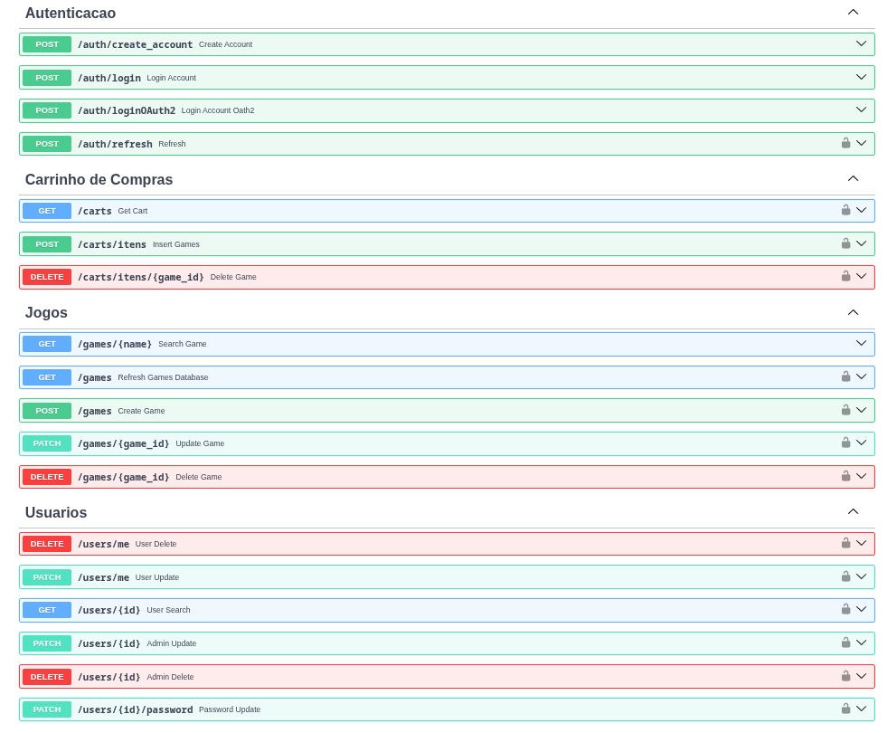

# GAMESPOT-Backend



API RESTfull programada em Python, com o uso de Webscrapping, banco de dados, testes unitários e docker, sendo o Backend do GameSpot

[Frontend do Gamespot](https://github.com/maxwilliamfs/GameSpot-Frontend)

## Funcionalidades
- CRUD de jogos e usuários
- Armazenamento em banco de dados não relacional
- Obtenção de dados por meio da rede
- Segurança por meio de JWT
- Segurança de testes pelo pytest

## Tecnologias e Ferramentas
- Linguagem: Python (3.14).
- Ambiente de Desenvolvimento: Arch Linux.
- IDE: JetBrains Pycharm
- Banco de Dados: MongoDB
- Ferramenta de WebScrapping: Selenium
- Conteinerização: Docker
- Versionamento: Git & GitHub.
- Testes: pytest

## Execução
### Execultando pelo terminal
- Clonar o repositório:
```bash
git clone [https://github.com/maxwilliamfs/GameSpot.git](https://github.com/maxwilliamfs/GameSpot.git)  
```
- Acessar o repositório:
```bash
cd GameSpot
```
- Executar projeto:  
```bash
docker compose up --build
```
#### Extra
- Executar testes automatizados:  
```bash
pytest -v
```

## Autor
**Max William Falcão Santos** - [Github](https://github.com/maxwilliamfs) [Linkedin](https://www.linkedin.com/in/max-william-falcao-santos-aa2675412/)
